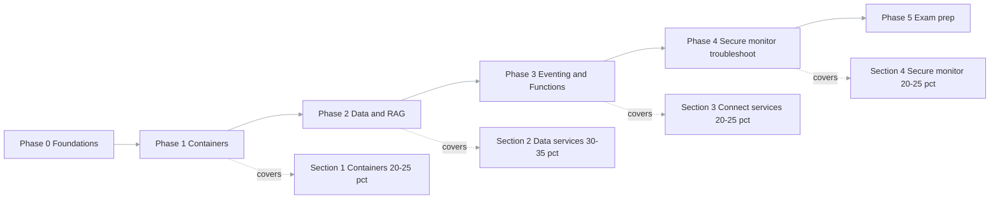

# AI-200 Certification Roadmap

> Phase-by-phase architecture that maps every AI-200 exam objective to a part of this project —
> so the same build makes you exam-ready **and** gives you a portfolio piece. This is the
> "all phases and sections" view: what you build, what it proves, and what you must study
> separately because the project doesn't cover it.

**Exam:** AI-200 — Developing AI Cloud Solutions on Azure (Azure AI Cloud Developer Associate).
Skills measured **as of October 7, 2026**. Pass score **700**. Preview features may appear if
commonly used. Official study guide: `https://aka.ms/AI200-StudyGuide`.

## Exam sections and weightings

| # | Section | Weight | This project covers it via |
| --- | --- | --- | --- |
| 1 | Develop containerized solutions on Azure | 20–25% | API + Worker containers, ACR, Container Apps, CI/CD |
| 2 | Develop AI solutions with Azure data management services | **30–35%** | Vector search (Cosmos / pgvector), Redis cache, embeddings, RAG |
| 3 | Connect to and consume Azure services | 20–25% | Blob → Event Grid → Function → Service Bus → Worker |
| 4 | Secure, monitor, troubleshoot Azure solutions | 20–25% | Key Vault, App Config, managed identity, OpenTelemetry, KQL |

Section 2 is the biggest, so it gets the most build and study time.

## Phase map (coverage at a glance)

## The phases

Each phase builds a slice of the system, proves one exam section, and leaves a portfolio artifact.
A phase is done only when its check passes **on Azure**, not just locally.

### Phase 0 — Foundations (local dev)

Not a scored section, but the base everything sits on.

- **Build:** .NET Aspire `AppHost` orchestrates the local system; Azurite for Blob; upload-a-PDF
  API slice against Azurite.
- **Local substitutes:** Azurite (Blob), SQL LocalDB, user secrets, console/Aspire-dashboard logs.
- **Portfolio artifact:** a running local system you can F5.
- **Done when:** a PDF uploads to Blob locally via the API.

### Phase 1 — Containerized solutions (Section 1, 20–25%)

- **Build:** Dockerfiles for API + Worker, push to Azure Container Registry, deploy to Container
  Apps, CI/CD in GitHub Actions, a KEDA scale rule on the Worker.
- **Study-only gaps** (not in the build — learn separately): deploying to **Azure App Service**,
  and deploying/managing **AKS with manifest files**. Read these; you don't have to build them.
- **Local:** build/run images with Docker; Container Apps itself has no emulator (run projects
  directly via Aspire).
- **Portfolio artifact:** a push to `main` auto-deploys the live API.
- **Done when:** images in ACR, API live on Container Apps, CI/CD green.

### Phase 2 — Data services and RAG (Section 2, 30–35% — largest)

- **Build:** store embeddings and run tenant-filtered vector similarity search in **Cosmos DB for
  NoSQL _or_ PostgreSQL + pgvector**; RAG with metadata filtering; **Azure Managed Redis** for
  query/embedding caching with expiration and invalidation.
- **Study-only gaps:** Cosmos **change feed processor**; **RU consumption + consistency levels**
  tuning; pgvector **compute/memory sizing** and indexing trade-offs. Touch these even if the
  project uses modest settings.
- **Local:** Cosmos emulator (supports vector search) or a Postgres+pgvector container; Redis
  container.
- **Portfolio artifact:** ask a question, get an answer grounded in the right tenant's invoices
  with sources cited; a test proving tenant isolation.
- **Done when:** RAG answers are grounded + tenant-isolated, and a repeat query is served from
  cache.

### Phase 3 — Connect to and consume services (Section 3, 20–25%)

- **Build:** Blob upload → **Event Grid** → **Azure Function** (triggers/bindings) → Document
  Intelligence → **Service Bus** → Worker; dead-letter handling; event filters and retries.
- **Study-only gaps:** Service Bus **topics/subscriptions** (the project may only use queues);
  Event Grid **custom events**. Read how they differ from what you built.
- **Local:** Service Bus emulator (Docker + SQL container); Event Grid has no emulator — simulate
  by POSTing the event to the Function's `runtime/webhooks/eventgrid` endpoint.
- **Portfolio artifact:** drop a PDF in Blob, ask about it a minute later.
- **Done when:** the full async pipeline runs end to end on Azure.

### Phase 4 — Secure, monitor, troubleshoot (Section 4, 20–25%)

- **Build:** **Key Vault** for secrets (rotation + retrieval), **App Configuration** for app
  settings, managed identity everywhere, Entra ID auth on the API, **OpenTelemetry** tracing to
  Application Insights, **KQL** queries + a workbook dashboard.
- **Study-only gaps:** Key Vault **secret rotation** specifics; **App Configuration** feature
  flags. Both are small add-ons to the build.
- **Local:** user secrets substitute for Key Vault; `DefaultAzureCredential` uses your `az login`
  identity; OTel exports to the Aspire dashboard/console.
- **Portfolio artifact:** zero secrets in config; one request traced end to end; a KQL dashboard
  screenshot.
- **Done when:** no connection strings in config, and one request is traced across every hop.

### Phase 5 — Exam preparation

- Take the official **Practice Assessment** (AI Skills Navigator / Microsoft Learn).
- Read the **Python SDK** equivalent of each Azure call you wrote in C# — the exam audience
  profile lists Python, and questions can be language-agnostic.
- Fill every study-only gap above; re-take the practice assessment until consistently > 700.
- **Done when:** practice score is consistently above passing and the exam is booked.

## Full objective checklist (track your readiness)

Mark each `[x]` when you can both **do it** and **explain it**. "Build" = proven by this project;
"Study" = not in the build, learn separately.

### Section 1 — Containerized solutions (20–25%)

- [ ] Build, store, version, manage images with **Azure Container Registry** — Build
- [ ] Build and run images with **ACR Tasks** — Build/Study
- [ ] Deploy containers to **Azure App Service** (env vars, secrets) — **Study**
- [ ] Deploy to **Azure Container Apps** (environment config, revision management) — Build
- [ ] Event-driven scaling with **KEDA** in Container Apps — Build
- [ ] Deploy/manage apps to **AKS** with manifest files — **Study**
- [ ] Monitor/troubleshoot AKS and Container Apps (logs, events, connectivity) — Build

### Section 2 — Data management services (30–35%)

- [ ] Connect to **Cosmos DB for NoSQL** with the SDK and run queries — Build
- [ ] Optimize query perf and **RU** use (indexing policies, consistency levels) — **Study**
- [ ] Store/retrieve embeddings + **vector similarity search** (Cosmos) — Build
- [ ] **Change feed processor** for new/updated items — **Study**
- [ ] Connect/query **Azure Database for PostgreSQL** with SDKs — Build (if chosen)
- [ ] Schema modeling + indexing strategies (pgvector) — Build/Study
- [ ] Configure compute/memory/storage for vector workloads — **Study**
- [ ] Vector similarity search + **RAG with metadata filter** — Build
- [ ] Connection optimization (throughput, latency) — Study
- [ ] **Azure Managed Redis**: caching, expiration, invalidation — Build
- [ ] Redis **vector indexing** for similarity search — Build/Study

### Section 3 — Connect to and consume services (20–25%)

- [ ] **Service Bus**: dead-letter, messages, topics, subscriptions — Build (queues) / Study (topics)
- [ ] **Event Grid**: filters, custom events, retries — Build/Study
- [ ] **Azure Functions**: serverless APIs, triggers and bindings — Build
- [ ] Configure and deploy **function apps** — Build

### Section 4 — Secure, monitor, troubleshoot (20–25%)

- [ ] **Key Vault**: secrets, rotation, retrieval — Build/Study
- [ ] **App Configuration**: store/retrieve app config — Build
- [ ] Distributed tracing with **OpenTelemetry** — Build
- [ ] **KQL** queries over logs and metrics — Build

## Study-only gaps (the exam-readiness short list)

These are the objectives the project does **not** force you to build. Schedule explicit study for
each — this is the difference between "I built a thing" and "I'll pass the exam":

1. **Azure App Service** deployment (Section 1).
2. **AKS + manifest files** (Section 1).
3. **Cosmos change feed processor** and **RU/consistency** tuning (Section 2).
4. **pgvector compute sizing** / connection optimization (Section 2).
5. **Service Bus topics/subscriptions** vs queues (Section 3).
6. **Key Vault rotation** and **App Configuration feature flags** (Section 4).
7. **Python SDK** fluency — read the Python form of each call (audience profile lists Python).

## Sources

- Study guide for Exam AI-200 (skills measured as of 2026-10-07):
  `https://learn.microsoft.com/credentials/certifications/resources/study-guides/ai-200`
- Certification page + practice assessment:
  `https://learn.microsoft.com/credentials/certifications/azure-ai-cloud-developer-associate/`
- Project blueprint and 8-week plan: `https://claude.ai/artifact/AGn8nxDEYipgqGNLqwewVV`
