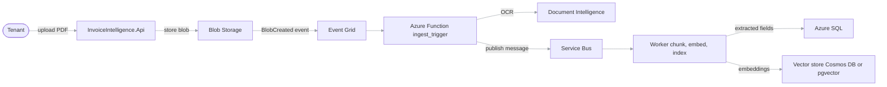
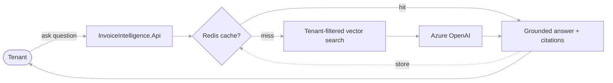

# Architecture

> A multi-tenant invoice intelligence platform on Azure: event-driven OCR ingestion, vector
> search, RAG over invoices, secured with managed identity and fully observable.

This document is the design reference for InvoiceIntelligence. It is written to double as an
**AI-200** study aid and an **interview talking-sheet** — the "Design decisions" section near the
end is the part reviewers ask about, so keep it in your own words as the system evolves.

## System overview

Tenants upload invoice PDFs. An event-driven pipeline runs OCR, stores the extracted fields in a
relational database, and indexes the content as embeddings in a tenant-partitioned vector store.
Users then ask natural-language questions and get answers generated by Azure OpenAI, grounded in
their own invoices with sources cited. Every tenant's data is isolated at every layer: storage,
cache, search and logs.

Two principles shape the design:

1. **Uploads never block the API.** Ingestion is asynchronous and event-driven, so a slow OCR run
   or a burst of uploads never degrades the query path.
2. **Tenant isolation is enforced by default, not by discipline.** Filtering by tenant is built
   into the data layer so application code cannot accidentally leak across tenants.

## Diagram

### Ingestion path (asynchronous)

### Query path (synchronous)

## Components

| Component | Project | Responsibility | Azure services |
| --- | --- | --- | --- |
| API | `src/InvoiceIntelligence.Api` | Upload endpoint, auth, RAG query endpoints | Container Apps, Entra ID |
| Core | `src/InvoiceIntelligence.Core` | Domain model, tenant context, Semantic Kernel services | — |
| Infrastructure | `src/InvoiceIntelligence.Infrastructure` | EF Core / SQL, vector store, Redis, Blob clients | Azure SQL, Cosmos DB / pgvector, Redis, Blob |
| Worker | `src/InvoiceIntelligence.Worker` | Service Bus consumer: chunk, embed, index | Service Bus, Azure OpenAI (embeddings) |
| Ingest function | `functions/ingest_trigger` | Blob/Event Grid → Document Intelligence → Service Bus | Functions, Event Grid, Document Intelligence |
| AppHost | `src/InvoiceIntelligence.AppHost` | .NET Aspire orchestration for local dev | — |

## Data flow

**Ingestion.** A tenant uploads a PDF through the API, which writes it to Blob Storage under a
tenant-scoped path. Blob Storage raises a `BlobCreated` event to Event Grid, which triggers the
`ingest_trigger` Azure Function. The function runs OCR with Document Intelligence and publishes a
message (tenant id, blob reference, extracted text) to Service Bus. The Worker consumes the
message, chunks the text, generates embeddings, writes the structured fields to Azure SQL, and
writes the embeddings to the tenant-partitioned vector store.

**Query.** A tenant asks a question through the API. The API checks Redis for a cached answer for
that tenant + question. On a miss, it runs a tenant-filtered vector search for the most relevant
invoice chunks, passes them to Azure OpenAI as grounding context, and returns the generated answer
with the source invoices cited. The answer is cached for repeat questions.

## Data stores

Two separate stores, often confused:

- **Azure SQL (relational, via EF Core)** — the *structured* extracted fields: invoice headers,
  line items, vendors, amounts, dates. Multi-tenancy via a `TenantId` column + EF Core global
  query filter.
- **Vector store (Cosmos DB for NoSQL *or* PostgreSQL + pgvector)** — the *embeddings* for
  semantic search, partitioned by tenant. Pick one: Cosmos DB for the most AI-200 overlap,
  pgvector for the most job-market overlap. Qdrant, if used, is local-only and not deployed to
  Azure.

## Multi-tenancy and isolation

Isolation is applied at every layer:

- **Storage** — blobs under tenant-scoped paths/containers.
- **Database** — `TenantId` on every tenant-scoped entity; an EF Core global query filter applies
  the current tenant automatically to every query. The tenant id is resolved from the request's
  auth claims, never from user input.
- **Vector search** — the index is partitioned by tenant and every search is filtered by tenant
  id before results are returned.
- **Cache** — Redis keys are namespaced by tenant so one tenant can never read another's cached
  answer.
- **Logs** — tenant id is attached to each trace as a dimension, so telemetry can be filtered per
  tenant without exposing data across tenants.

**Proof, not assertion:** an automated test uploads for Tenant A and Tenant B and asserts Tenant A
can never retrieve Tenant B's invoices. That test is the credible evidence of isolation.

## Security

- **No secrets in code or config.** Connections use managed identity; `DefaultAzureCredential`
  authenticates via the developer's identity locally and the Container App's managed identity in
  Azure. Azure SQL uses a passwordless connection string (`Authentication="Active Directory
  Default"`).
- **Key Vault** holds any remaining secrets, referenced by managed identity.
- **Entra ID** protects the API's endpoints.

## Observability

- **OpenTelemetry** instruments the API, Worker and Function; traces, metrics and logs flow to
  **Application Insights**.
- A single upload-to-answer request is traceable **end to end** across the async hops (API → Blob
  → Function → Service Bus → Worker, and the query path).
- **KQL** queries over **Log Analytics** back a workbook dashboard (cache hit rate, ingestion
  latency, error rates per tenant).

## Deployment and infrastructure

- **Container Apps** host the API and Worker; images are built and pushed to **Container
  Registry**.
- **Bicep** (`infra/main.bicep`) declares all Azure resources, so the whole environment rebuilds
  from one command — which is also what makes the cost-control teardown/rebuild loop safe.
- **GitHub Actions** (`.github/workflows/ci-cd.yml`) build, test, push the image, and deploy; a
  push to `main` redeploys automatically.

## Design decisions

> Own these in your own words — this is the section interviewers probe.

- **Why event-driven ingestion?** Decoupling upload from OCR/indexing with Event Grid + Service
  Bus keeps the API responsive, absorbs upload bursts, and lets OCR and indexing fail and retry
  independently without losing work.
- **Why a separate Worker from the Function?** The Function's job is cheap and bursty (receive
  event, OCR, enqueue); the Worker's job is heavier and benefits from being a long-running,
  independently scalable container.
- **Why managed identity over connection strings?** Removes stored secrets entirely, the same code
  path works locally and in Azure, and it maps cleanly to the AI-200 "secure" objectives.
- **Why Cosmos DB vs PostgreSQL + pgvector?** _(record the one you chose and the trade-off:_
  _exam overlap vs job-market overlap, cost, and operational familiarity.)_
- **Why cache in Redis?** Repeated questions are common and LLM calls are the expensive step;
  caching per tenant cuts cost and latency, and the hit rate is a visible success metric.

## AI-200 skill coverage

| AI-200 area | Where it shows up here |
| --- | --- |
| Develop containerized solutions | API + Worker as containers, CI/CD to Container Apps |
| Develop AI solutions with data services | Embeddings + tenant-partitioned hybrid search, query cache |
| Connect to and consume Azure services | Blob → Event Grid → Function → Document Intelligence → Service Bus → Worker |
| Secure, monitor, troubleshoot | Managed identity, Key Vault, Entra ID, App Insights, OpenTelemetry, KQL |

## Source

Full blueprint and 8-week plan: InvoiceIntelligence – AI-200 Portfolio Blueprint
(`https://claude.ai/artifact/AGn8nxDEYipgqGNLqwewVV`).
